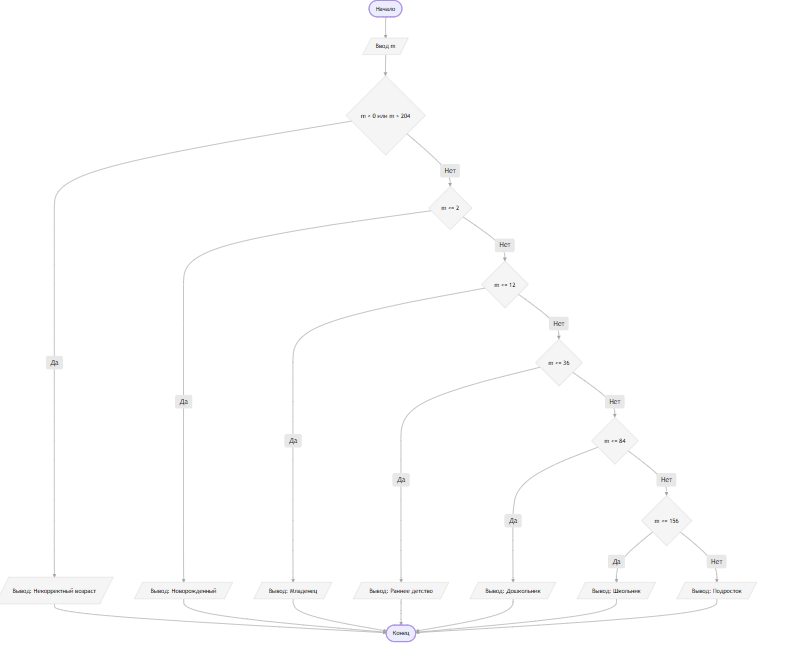

# Домашнее задание к работе 7
## Задача:
Написать программу, которая по введенному возрасту в месяцах выводит
возрастную категорию ребенка (новорожденный – до 2 мес., младенец – до 1
года; раннее детство – 1-3 года; дошкольник – 3-7 лет; школьник – 7-13 лет,
подросток – 13-17 лет).
### Алгоритм
1.Начало.
2.Ввод данных: запросить и считать целое число m (возраст в месяцах).
3.Проверка корректности:
Если m < 0 или m > 204, вывести сообщение о том, что возраст вне диапазона задачи, и завершить программу.
4.Выбор и вывод по switch(category):
 case 0 ... 2:
            printf("Возрастная категория: Новорожденный\n");
            break;
        case 3 ... 12:
            printf("Возрастная категория: Младенец\n");
            break;
        case 13 ... 36:
            printf("Возрастная категория: Раннее детство\n");
            break;
        case 37 ... 84:
            printf("Возрастная категория: Дошкольник\n");
            break;
        case 85 ... 156:
            printf("Возрастная категория: Школьник\n");
            break;
        case 157 ... 204:
            printf("Возрастная категория: Подросток\n");
            break;
5.Конец.
### Блок-схема
 
## Реализация программы
#define _CRT_SECURE_NO_WARNINGS
#include <stdio.h>
#include <locale.h>

int main() {
	setlocale(LC_ALL,"RUS");
int months;

    printf("Введите возраст ребенка в месяцах: ");
    if (scanf("%d", &months) != 1) {
        printf("Ошибка ввода.\n");
        return 1;
    }

    switch (months) {
        case 0 ... 2:
            printf("Возрастная категория: Новорожденный\n");
            break;
        case 3 ... 12:
            printf("Возрастная категория: Младенец\n");
            break;
        case 13 ... 36:
            printf("Возрастная категория: Раннее детство\n");
            break;
        case 37 ... 84:
            printf("Возрастная категория: Дошкольник\n");
            break;
        case 85 ... 156:
            printf("Возрастная категория: Школьник\n");
            break;
        case 157 ... 204:
            printf("Возрастная категория: Подросток\n");
            break;
        default:
            if (months < 0) {
                printf("Возраст не может быть отрицательным.\n");
            } else {
                printf("Возраст старше 17 лет (вне категорий задачи).\n");
            }
            break;
    }

    return 0;
}
## 4. Информация о разработчике
  Овчинников Артём БИЦТ-262

